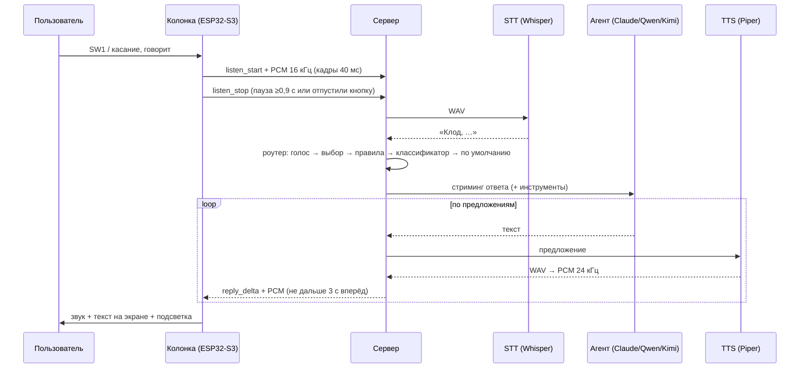

# Архитектура

Колонка — тонкий клиент: звук, экран, свет и кнопки. Вся «умность» живёт на сервере. Поэтому модели меняются без перепрошивки, а локальные Qwen или Kimi на мощном компьютере работают наравне с облачным Claude.

## Поток данных одного вопроса

## Откуда берутся задержки

**«Время до первого звука»** складывается из трёх частей:

1. **Распознавание всей фразы.** На GPU это 0,2–0,6 с, на CPU — 1–3 с, в зависимости от модели Whisper.
2. **Первый токен агента.** У облака 0,5–1,5 с, у локальной модели — от 0,1 с.
3. **Синтез первого предложения.** У Piper на CPU это 0,1–0,3 с.

**Как сервер сокращает ожидание:**

- Первое предложение отправляется в TTS сразу, даже если оно короткое («Конечно.»). Следующие склеиваются в куски по 40 символов и больше.
- Следующие предложения синтезируются заранее, пока звучат текущие: опережение — два предложения.
- Колонка начинает играть, когда накопилось 180 мс звука.
- `normalize_peak` подтягивает громкость фразы перед Whisper, потому что INMP441 тихий.

Задержки каждой реплики (STT, первый токен, первый звук, всего) пишутся в лог и в историю веб-панели.

## Сервер (`server/src`)

| Модуль | Роль |
|---|---|
| `app.rs` | собирает всё вместе: HTTP, WebSocket, mDNS, проверки здоровья агентов |
| `hub.rs` | протокол колонки: сессии, приём звука, команды |
| `session.rs` | состояние колонки: громкость, выбранный агент, история разговора |
| `assistant.rs` | конвейер хода: STT → команды → роутер → агент с запасными → озвучка → история |
| `agents/mod.rs` | общий тип агента и реестр, таймауты «первого токена», классификация ошибок |
| `agents/anthropic.rs` | Claude: стриминг, `tool_use` → `tool_result` |
| `agents/openai.rs` | OpenAI-совместимые серверы: стриминг, `tool_calls`, вырезание `<think>`, повтор без tools |
| `agents/router.rs` | выбор агента и порядок запасных |
| `agents/tools.rs` | инструменты (время, погода, таймер, громкость, свет, `ask_agent`, `switch_agent`) |
| `speech/stt.rs`, `speech/tts.rs` | клиенты распознавания и синтеза |
| `speech/streamer.rs` | очередь «предложение → TTS → PCM → колонка» с темпом |
| `text/sentences.rs` | нарезка потокового текста на предложения |
| `text/clean.rs` | чистка markdown и эмодзи, фильтр `<think>` |
| `store.rs` | SQLite (rusqlite, встроенный): колонки и история; без доступа к файлу — память |
| `timers.rs` | таймеры колонок |

**Контекст разговора** общий для всех агентов колонки. Если ты спросил Qwen, а потом обратился к Claude, Claude видит предыдущий обмен. Хранятся последние `history_turns` обменов; после `idle_reset_minutes` тишины разговор начинается заново.

**Ошибки и запасные агенты.** Каждый агент раз в минуту проверяется через `/models`, а у Claude — через наличие ключа и Models API. Если при ответе случилась ошибка соединения, таймаут или ошибка авторизации, агент помечается недоступным до следующей проверки, а ход продолжает следующий агент из `fallback`. Если текст уже начал звучать, ответ завершается фразой «Извини, ответ оборвался», чтобы не начинать сначала.

## Прошивка (`firmware/`, Rust)

Поведение отделено от железа: всё, что можно, живёт в `firmware/core` и проверяется `cargo test` на ПК; `firmware/esp` — тонкий слой ESP-IDF.

| Модуль | Роль |
|---|---|
| `core/src/app.rs` | состояния колонки: Connecting → Idle → Listening → Thinking → Speaking; кнопки, тач, события сервера. Железо — за трейтом `Hw` |
| `core/src/ui.rs` | интерфейс 320×240 на embedded-graphics: центр рисуется в буфер в PSRAM, кириллица — шрифты ISO-8859-5 |
| `core/src/leds.rs` | эффекты матрицы WS2812B (кадр с гаммой и ограничением яркости) |
| `core/src/dsp.rs`, `ring.rs` | звук (32 бит стерео → 16 бит моно, ФВЧ, громкость, передискретизация), детектор речи, кольцевой буфер |
| `core/src/mdns.rs`, `touch.rs` | поиск сервера (свой mDNS-запрос), калибровка тача по 3 точкам |
| `esp/src/audio.rs` | I2S0 — микрофоны, I2S1 — ЦАП; потоки на двух ядрах |
| `esp/src/net.rs` | Wi-Fi, mDNS, WebSocket (tungstenite) в отдельном потоке |
| `esp/src/display.rs`, `touch.rs` | ILI9341 (mipidsi) и XPT2046 на общей шине SPI, подсветка ШИМ |
| `esp/src/leds.rs`, `battery.rs`, `prefs.rs` | RMT для WS2812B, АЦП батареи, настройки в NVS |
| `esp/src/bin/hwtest.rs` | проверка железа без сервера: кнопки, микрофоны, экран, тач |

**Звук.** Микрофоны читаются постоянно, на ядре 0, блоками по 16 мс. Поток на сервер включается только в режиме «слушаю». Пока колонка молчит, из этих блоков оценивается фоновый шум для детектора речи.

**Воспроизведение** идёт из кольцевого буфера в PSRAM (1 МБ) задачей на ядре 1. Громкость — программная, с потолком `VOLUME_MAX_GAIN_DB`, чтобы TPA3116 на 12 В не сжёг 10-ваттный динамик.

**Конец фразы.** В режиме «нажал и отпустил» его определяет энергетический детектор речи `dsp::Vad`: адаптивный порог по фону, конец после 900 мс тишины, отмена, если речи не было 5 секунд. В режиме удержания фраза заканчивается, когда отпускаешь кнопку.
